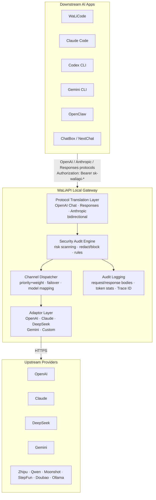
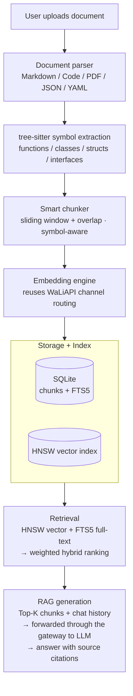

<div align="center">


# WaLiAPI

### Local-First LLM API Gateway · Multi-Protocol · Knowledge Base RAG · MCP Tools

**Unify OpenAI, Claude, DeepSeek, Gemini and more behind one local gateway.**<br>
**One key, one protocol, one complete audit log — for Claude Code, Codex CLI, Gemini CLI, WaLiCode and any AI coding tool.**

[](./src-tauri/tauri.conf.json)
[](./LICENSE)
[](#getting-started)
[](https://tauri.app)

**[Download](#getting-started)** &nbsp;·&nbsp; **[Features](#core-features)** &nbsp;·&nbsp; **[How It Works](#how-it-works)** &nbsp;·&nbsp; **[Docker](#option-2-docker-deployment-recommended-for-servers-and-teams)**

[简体中文](README.md) &nbsp;|&nbsp; **English** &nbsp;|&nbsp; [日本語](README.ja.md)

</div>

---

## 🧭 WaLiAPI in 30 Seconds

The diagram below shows the complete workflow: AI applications on the left, the WaLiAPI processing pipeline in the middle, and your configured upstream model channels on the right.

```mermaid
flowchart LR
    subgraph Clients["💬 Downstream AI Apps"]
        direction TB
        A1["Claude Code"]
        A2["Codex CLI"]
        A3["Gemini CLI"]
        A4["WaLiCode"]
        A5["OpenClaw"]
        A6["ChatBox / NextChat"]
    end

    subgraph Gateway["🛡️ WaLiAPI Local Gateway  127.0.0.1:8777"]
        direction TB
        B["① Multi-Protocol Ingress<br/>OpenAI Chat · Responses · Anthropic"]
        C["② Security Audit<br/>Secret Scanning · Redact / Block"]
        D["③ Smart Routing<br/>Priority + Weight · Multi-Key · Failover"]
        E["④ Protocol Conversion · Upstream Adaptors<br/>OpenAI · Claude · Gemini · DeepSeek · Custom"]

        B --> C --> D --> E
    end

    subgraph Providers["☁️ Upstream Providers"]
        direction TB
        F1["OpenAI / Claude"]
        F2["DeepSeek / Gemini"]
        F3["Zhipu / Qwen / Moonshot / Doubao"]
        F4["StepFun / Ollama / Custom"]
    end

    Clients -- "Unified key<br/>sk-waliapi-*" --> B
    E -- "HTTPS" --> Providers

    style Clients fill:#f0f7ff,stroke:#4a90d9,color:#1a3a5c
    style Gateway fill:#f6f0ff,stroke:#7c5cd6,color:#3a2a5c
    style Providers fill:#f0fdf4,stroke:#34a853,color:#1a4a2c
```



**In one sentence**: point every downstream AI app at WaLiAPI — it handles protocol translation, security auditing, load balancing and request logging, then forwards traffic to the upstream channels you configured. When a channel runs out of quota or fails, requests fail over to the next candidate automatically and your AI tools never notice.

## 🌟 Why WaLiAPI

- **🔌 One entry, many protocols** — Downstream clients connect with OpenAI Chat Completions, OpenAI Responses, or Anthropic Messages. The gateway translates bidirectionally, and upstream channels never know the difference. Run DeepSeek inside Claude Code, or Kimi inside Codex — you decide.
- **⚖️ Never waste a token of quota** — Channels are balanced by priority and weight, each channel supports multiple API Keys with per-key weights; exhausted or failing channels fail over automatically. Quota is visible at a glance (e.g. per-model remaining quota and reset time for Antigravity accounts).
- **🛡️ Know exactly what your AI is saying** — Every request/response is fully logged and searchable by keyword, key, channel, model, and Trace ID. 25+ built-in security rules scan for secret leakage, sensitive path exposure and Unicode steganography, with audit / warn / redact / block policies.
- **📚 More than a gateway** — Built-in Knowledge Base RAG engine (tree-sitter symbol-aware chunking, HNSW + FTS5 hybrid retrieval), a Wiki knowledge engine, and an MCP Server with 29 tools, so your AI agents can query private knowledge directly.
- **🏠 Local-first, data stays yours** — Desktop app runs locally with SQLite storage; a Docker / headless server build is available for team and private deployments.

- GitHub: [https://github.com/fuzhengwei/WaLiAPI](https://github.com/fuzhengwei/WaLiAPI)
- Gitcode: [https://gitcode.com/fuzhengwei/WaLiAPI](https://gitcode.com/fuzhengwei/WaLiAPI)

---

## 📑 Table of Contents

- [Getting Started](#getting-started)
- [How It Works](#how-it-works)
- [Core Features](#core-features)
- [Multi-Protocol Access](#multi-protocol-access)
- [Tech Stack](#tech-stack)
- [Project Structure](#project-structure)
- [Security Boundary & Threat Model](#security-boundary--threat-model)
- [Version History](#version-history)
- [Contributors](#contributors)
- [License](#license)

---

## 🚀 Getting Started

WaLiAPI offers two deployment options: **desktop app** (for individual local use) and **Docker deployment** (for teams and cloud servers).

### Option 1: Desktop App (Recommended for individuals)

#### 1. Download

Download the installer for your platform from GitHub Releases:

- GitHub: [https://github.com/fuzhengwei/WaLiAPI/releases](https://github.com/fuzhengwei/WaLiAPI/releases)

| Platform | Format | Architecture |
|:---|:---|:---|
| macOS | `.dmg` | ARM64 (Apple Silicon) |
| Windows | `.msi` / `.exe` | x64 |
| Linux | `.deb` / `.AppImage` | x64 |

#### 2. Add a Channel

Open WaLiAPI → **Channels** → **New Channel** → fill in name, Base URL, API Key, supported models → Save. You can also paste a `curl` command to auto-fill the form, or sign in with OAuth accounts (Codex, Kimi, Grok, Antigravity, WorkBuddy) under **Auth Accounts**.

#### 3. Create a Key

**API Keys** → **New Key** → generates a local access token in `sk-waliapi-*` format.

#### 4. Connect Downstream Apps

In ChatBox / NextChat / OpenAI SDK / WaLiCode, configure:

- **Base URL**: `http://127.0.0.1:8777/v1`
- **API Key**: the `sk-waliapi-...` key you created

#### 5. One-Click App Config (Optional)

On the **App Config** page, pick an installed AI coding tool and write the gateway address and key into its config file with one click — 8 tools supported: Claude Code, Codex CLI, Gemini CLI, Claude Desktop, OpenCode, OpenClaw, Hermes Agent, WaLiCode.

### Option 2: Docker Deployment (Recommended for servers and teams)

WaLIAPI ships a Docker image built for long-running Linux servers. Multi-stage build (Node/pnpm compiles the frontend, Rust compiles the server binary), non-root runtime, SQLite persisted at `/data`.

```bash
# Pull the image
docker pull fuzhengwei/waliapi:latest

# Generate admin tokens
export WALIAPI_ADMIN_TOKEN="$(openssl rand -hex 32)"
export WALIAPI_MCP_TOKEN="$(openssl rand -hex 32)"

# Start the container
docker run -d --name waliapi \
  -p 127.0.0.1:8777:8777 \
  -v waliapi-data:/data \
  -e WALIAPI_ADMIN_TOKEN \
  -e WALIAPI_MCP_TOKEN \
  fuzhengwei/waliapi:latest

# Verify
curl http://127.0.0.1:8777/health
```

Or build from source with Docker Compose:

```bash
git clone https://github.com/fuzhengwei/WaLiAPI.git
cd WaLiAPI
export WALIAPI_ADMIN_TOKEN="$(openssl rand -hex 32)"
export WALIAPI_MCP_TOKEN="$(openssl rand -hex 32)"
docker compose up -d --build
curl http://127.0.0.1:8777/health
```

#### Configuration

| Variable | Description | Default |
|:---|:---|:---|
| `WALIAPI_SERVER_HOST` | Listen address | `0.0.0.0` (Docker) / `127.0.0.1` (desktop) |
| `WALIAPI_SERVER_PORT` | Listen port | `8777` |
| `WALIAPI_DATA_DIR` | Data directory (SQLite + KB index) | `/data` |
| `WALIAPI_ADMIN_TOKEN` | Admin token for KB/Wiki REST management (`/api/kb`, `/api/wiki`) (≥32 chars, Bearer) | — |
| `WALIAPI_MCP_TOKEN` | MCP endpoint token (≥32 chars, must differ from admin) | — |
| `WALIAPI_PUBLIC_URL` | Public URL (used when generating client configs) | — |

Compose binds only to `127.0.0.1` by default. For public exposure, terminate TLS with Caddy or Nginx and reverse-proxy to `127.0.0.1:8777` (example: [`deploy/caddy/Caddyfile.example`](deploy/caddy/Caddyfile.example)). A systemd deployment guide is available in the [Chinese README](README.md).

---

## 🔄 How It Works

WaLiAPI sits between downstream AI applications and upstream model providers, doing protocol translation, load balancing, security auditing and request logging. It also ships a knowledge base engine, a Wiki knowledge engine and an MCP Server so AI agents can query private knowledge directly.

### Request Flow



<details>
<summary>📁 Knowledge Base RAG Pipeline</summary>



</details>

<details>
<summary>🔗 MCP Tool Service</summary>

WaLiAPI ships a built-in MCP (Model Context Protocol) Server on the `/mcp` endpoint exposing **29 tools** (13 knowledge base + 16 Wiki), compatible with any MCP-capable AI agent via Streamable HTTP + SSE.

KB tools (13): semantic search, RAG Q&A, document read, KB CRUD, document upload/delete, index management, multi-source import.
Wiki tools (16): project CRUD, page CRUD, search, Q&A, tags, knowledge graph, source management, ingestion.

</details>

---

## 🎯 Core Features

### 🔌 Multi-Channel Management

- **11 channel types**: OpenAI, DeepSeek, Claude, Gemini, Zhipu, Qwen, Moonshot, StepFun, Doubao, Ollama, and custom channels
- Priority + weight load balancing with automatic failover
- **Multi-Key load balancing**: multiple API Keys per channel with per-key weights
- Channel copy, connectivity testing with latency/error display
- Channel-level model mapping; per-channel stats (calls, tokens, success rate, latency)

### 🔑 Key Management

- `sk-waliapi-*` local access keys for downstream apps
- Quota limits, enable/disable, per-key stats

### 📊 Dashboard

- Six core metrics: today's requests/tokens, total requests/tokens, active channels, average latency
- Service availability badge with color-coded health
- Dynamic operations suggestions

### 📝 Audit Logs

- Full request/response recording: bodies, model params, tool calls, token usage, status codes
- Search by keyword, key, channel, model, date range, Trace ID
- Auto-refresh every 5 seconds while the page is visible; log retention policies

### 🛡️ Security Audit Center

- **Risk detection engine**: secret leakage (API keys, private keys, JWT, cookies, bearer tokens), sensitive file paths (`~/.ssh`, `.env`, cloud credentials), Unicode steganography, suspicious tool calls, network risks, tracking pixels
- **Risk levels**: clean / info / low / medium / high / critical with 0–100 scoring
- **Policies**: audit-only / warn / redact / block; audit-only by default
- **Rule management**: 25+ built-in rules + custom black/white lists

### 📚 Knowledge Base Engine

- **Parsing**: Markdown, code files (20+ languages), PDF (incl. scanned PDFs via VLM OCR), JSON/YAML/CSV
- **Symbol-aware chunking**: tree-sitter preserves function/class boundaries
- **Hybrid retrieval**: HNSW vector search + SQLite FTS5 full-text with weighted fusion
- **RAG Q&A**: Top-K retrieval + chat history → LLM answer with source citations
- **Multi-source import**: Git repos, URL batches, local directories

### 📓 Wiki Knowledge Engine

- Structured projects/pages in Markdown + frontmatter, directory hierarchy
- Ingestion pipeline with automatic tag and `[[wikilinks]]` extraction
- Page search, Wiki Q&A with citations, knowledge graph visualization, tag system

### 🔗 MCP Server

- 29 tools (13 KB + 16 Wiki) over Streamable HTTP + SSE at `/mcp`
- Compatible with Claude Desktop, OpenClaw, and any MCP-capable agent

### ⚙️ More

- **Settings**: themes (dark/light/system), tray, auto-start, retry policy
- **App Config**: one-click config for 8 AI coding tools
- **Import/Export**: channel JSON backup, WaLiCode backup import
- **Streaming**: full SSE forwarding with usage parsing

---

## 🔗 Multi-Protocol Access

WaLiAPI translates protocols at the gateway: multi-protocol ingress, unified egress — upstream channels stay unaware.

| Protocol | Endpoint | Auth | Notes |
|:---|:---|:---|:---|
| **OpenAI Chat Completions** | `POST /v1/chat/completions` | `Authorization: Bearer sk-waliapi-*` | Standard compatible, streaming supported |
| **OpenAI Responses** | `POST /v1/responses` | `Authorization: Bearer sk-waliapi-*` | Bidirectional Responses conversion |
| **Anthropic Messages** | `POST /v1/messages` | `x-api-key: sk-waliapi-*` | Anthropic protocol with header conversion |
| **OpenAI Embeddings** | `POST /v1/embeddings` | `Authorization: Bearer sk-waliapi-*` | Embeddings, reused by the knowledge base |
| **Model List** | `GET /v1/models` | `Authorization: Bearer sk-waliapi-*` | Aggregates channels + auth accounts |
| **Health** | `GET /health` | none | Liveness probe |
| **MCP** | `POST /mcp` / `GET /mcp` | — | MCP Streamable HTTP + SSE |
| **Knowledge Base API** | `/api/kb/*` | — | KB CRUD, search, RAG |

Quick test with curl:

```bash
curl http://127.0.0.1:8777/v1/chat/completions \
  -H "Authorization: Bearer sk-waliapi-xxxx" \
  -H "Content-Type: application/json" \
  -d '{
    "model": "gpt-4o",
    "messages": [{"role": "user", "content": "Hello!"}]
  }'
```

---

## 🏗️ Tech Stack

| Layer | Technology |
|:---|:---|
| Frontend | React 19 + TypeScript + Vite 7 + Tailwind CSS 4 + React Router 7 |
| Backend | Rust (edition 2021) + Tauri 2 + Axum 0.8 + sqlx (SQLite) + reqwest + tokio |
| Knowledge Base | tree-sitter (7 languages) + HNSW + FTS5 + bincode |
| Wiki | Markdown + frontmatter parsing + wikilinks graph + SQLite |
| Packaging | Tauri bundler (.dmg / .msi / .deb / .AppImage), Docker multi-stage build |

---

## 📁 Project Structure

```
WaLiAPI/
├── src/                      # Frontend source (desktop + web panel reuse)
│   ├── pages/                # 9 pages: Dashboard / Channels / AuthChannels / ApiKeys / Logs
│   │                         #   / KnowledgeBase / Usage / Settings / AppConfig
│   ├── components/           # ChannelForm, auth/, channel-form/, layout/ ...
│   ├── lib/                  # api.ts, runtime.ts (unified command transport layer)
│   └── types/                # TypeScript types
├── web/                      # Web admin panel (pnpm sub-package, @app alias reuses ../src)
├── src-tauri/                # Rust backend
│   ├── src/
│   │   ├── main.rs           # Desktop entry (default-run = "waliapi")
│   │   ├── bin/waliapi-web.rs # Headless server entry
│   │   ├── server/           # Axum HTTP server: router, handlers, admin, event bridge
│   │   ├── core/             # Core dispatch: proxy, dispatcher, route plan, stream supervisor
│   │   ├── endpoint_executor/# Endpoint executors (request driver, SSE, token estimation)
│   │   ├── auth_provider/    # Auth accounts (Codex / Kimi / Antigravity / Grok / WorkBuddy OAuth)
│   │   ├── protocol/         # Protocol codecs (chat / messages / responses, SSE bridge)
│   │   ├── adaptor/          # Upstream adaptors: openai / claude / deepseek / gemini / custom
│   │   ├── security/         # Security audit: scanner, rules, redact
│   │   ├── services/         # knowledge/ (RAG), wiki/, mcp/, channel_test
│   │   ├── commands/         # Tauri commands
│   │   └── db/               # Database init, models, repository
│   └── migrations/           # SQL migrations (auto-applied with auto-backup)
├── deploy/                   # Caddy / systemd examples
├── scripts/                  # pdfium fetch, release sync scripts
└── .github/workflows/        # Release workflows
```

---

## 🛡️ Security Boundary & Threat Model

WaLiAPI is designed **local / intranet first**. Read this section before deploying publicly.

**Credentials & permissions**:

| Purpose | Credential |
|:---|:---|
| Data plane `/v1/*` | `sk-waliapi-*` gateway keys |
| Web admin panel | Admin login session (initial password generated on first start, stored in `INITIAL_PASSWORD` file and deleted after first login) |
| KB/Wiki management REST | `WALIAPI_ADMIN_TOKEN` (≥32 chars) |
| RAG REST / MCP queries | API Keys authorized for the knowledge base |
| MCP admin tools / Wiki / SSE | `WALIAPI_MCP_TOKEN` (≥32 chars, must differ from admin token) |

**Plaintext key storage (disclosure)**: upstream channel keys and gateway API keys are stored **in plaintext** in the local SQLite data directory — filesystem permissions are the security boundary; static encryption is not provided. Channel export files contain plaintext keys (the UI warns explicitly).

**Security scanning boundary (best-effort DLP)**: the built-in risk scanner is heuristic — a best-effort data-leak-prevention layer, not a complete content-safety solution. Response-side scanning is fail-open; scan-budget overruns reject requests fail-closed.

**CORS scope**: permissive CORS (`Access-Control-Allow-Origin: *`) applies **only** to data-plane gateway routes (API-key authenticated `/v1/*`). Admin, KB/Wiki REST and MCP endpoints carry no permissive CORS; the admin panel adds CSRF protection.

**Public deployment advice**: Docker binds only to `127.0.0.1` by default; terminate TLS with Caddy/Nginx, inject strong `WALIAPI_ADMIN_TOKEN` / `WALIAPI_MCP_TOKEN`, never strip auth headers in the proxy, and keep a single instance (SQLite does not support multi-writer).

---

## 📌 Version History

The full release history (in Chinese) is maintained in the [main README](README.md#-版本历史). Latest release:

### v0.4.3 (2026-10-17)

- ✨ **Software Integration (Link)**: the MCP capability domain evolves into `services/software` (software integration), with a new Link entry in the sidebar and Knowledge Base page (experimental); command layer, MCP handlers, server/admin routes and knowledge access control adapted accordingly
- ✨ **OpenAPI / Swagger one-click import**: paste an OpenAPI 3.x / Swagger 2.0 (JSON/YAML) document to generate a generic_http connector config — each operation becomes an MCP tool, with tool names, path/query parameters, request bodies and risk levels derived automatically
- ✨ **Conversational instance management over MCP**: external AI agents can discover connectors, import OpenAPI and create / update / delete software instances via `/mcp`; deletions require explicit `confirm: true` and instance-level tools are gated by the approval policy
- ✨ **CLI-Hub integration**: one-click install + instance creation from the CLI-Anything community catalog (103+ tools); new `ClihubConnector` with `help` / `run` tools; falls back to a built-in curated catalog when the hub is not installed
- 🎨 **Software page overhaul**: SoftwarePage reworked for instance management and online debugging; Knowledge Base page gains an "available tools" table and in-page key trial calls
- 🐛 **Desktop /mcp online-call proxy**: new `mcp_online_call` command proxies requests to the local `/mcp` from the Rust side, working around WKWebView mixed-content / CORS restrictions on loopback URLs
- 🐛 **Qoder streaming decode fix**: inner Chat chunks were fed to the SSE parser as bare JSON and silently dropped, making streaming requests fail with "no message_start emitted" (non-streaming was unaffected); chunks are now re-framed as SSE records and the inner decoder is selected per downstream protocol, with 6 new regression tests covering Responses / Chat / Messages streaming

<details>
<summary><b>v0.4.2 (2026-10-16)</b></summary>

- ✨ **Qoder Auth Provider**: new `auth_provider/qoder_backend.rs`, `qoder_cosy.rs` and `qoder_login.rs`; the Auth account system now supports Qoder OAuth sign-in, token refresh and model discovery, with a new `protocol/codec/qoder/` codec registered in the codec registry
- ✨ **Wiki PDF ingestion fixed end-to-end** (PR #159, @freakojc): rewritten `services/wiki/ingest.rs`, enhanced OCR rendering; API Keys can now be granted fine-grained knowledge-base / Wiki access; per-feature reasoning temperature for RAG and Wiki Q&A; modular ingest progress state
- ✨ **Observability & dashboard**: request-intent classification (`prompt_classify.rs`), new `RouteMapCard` routing-map and `TokenHeatmap` components on the Dashboard
- ✨ **API log client identification**: downstream clients (Claude Code / Codex / ChatBox …) are recognized from request signatures, stored, and filterable in the Logs page
- 🐛 **Old-WebKit gradient compatibility fix (ADR 0002)**: `bg-gradient-to-*` emitted `in oklab` interpolation syntax that old WKWebView silently drops, blanking gradient backgrounds (e.g. the WaLiAPI gateway icon on the Route Map card); fixed once in `App.css` for the whole codebase
- 📝 **Multilingual README**: new "WaLiAPI in 30 Seconds" Mermaid diagram, English and Japanese versions with a language switcher
- 🔧 **Version bump to 0.4.2** (package.json / Cargo.toml / tauri.conf.json / Cargo.lock)

</details>

---

## 👥 Contributors

> WaLiAPI is built by a passionate open-source community. Thanks to the following developers (sorted by contributions). The detailed table (in Chinese) is in the [main README](README.md#-贡献者).

<a href="https://github.com/fuzhengwei/WaLiAPI/graphs/contributors">
  
</a>

---

## 📄 License

[MIT](./LICENSE)

You are free to use WaLiAPI commercially, personally, and to modify and redistribute it, provided the original copyright and license notices are retained. See the [Chinese README](README.md#-license) for the detailed permission table.

---

<div align="center">
  <sub>Built with ❤️ by the WaLiAPI community</sub>
</div>
