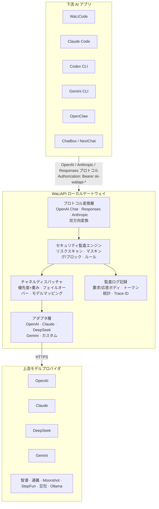
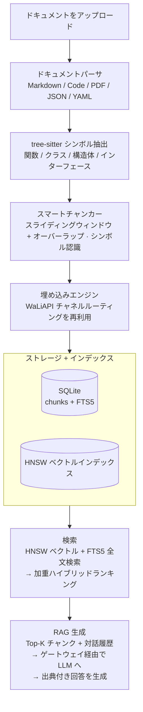

<div align="center">


# WaLiAPI

### ローカル完結型 LLM API ゲートウェイ · マルチプロトコル · ナレッジベース RAG · MCP ツール

**OpenAI、Claude、DeepSeek、Gemini などの上流モデルを、ひとつのローカルゲートウェイに統合。**<br>
**ひとつのキー、ひとつのプロトコル、完全な監査ログで、Claude Code・Codex CLI・Gemini CLI・WaLiCode などの AI コーディングツールに接続。**

[](./src-tauri/tauri.conf.json)
[](./LICENSE)
[](#はじめに)
[](https://tauri.app)

**[ダウンロード](#はじめに)** &nbsp;·&nbsp; **[主な機能](#主な機能)** &nbsp;·&nbsp; **[仕組み](#仕組み)** &nbsp;·&nbsp; **[Docker デプロイ](#方法-2docker-デプロイチーム・サーバー向け)**

[简体中文](README.md) &nbsp;|&nbsp; [English](README.en.md) &nbsp;|&nbsp; **日本語**

</div>

---

## 🧭 30 秒でわかる WaLiAPI

次の図は WaLiAPI の全体的な動作フローです。左側がリクエストを送る AI アプリ、中央が WaLiAPI ゲートウェイの処理チェーン、右側が設定済みの上流モデルチャネルです。

```mermaid
flowchart LR
    subgraph Clients["💬 下流 AI アプリ"]
        direction TB
        A1["Claude Code"]
        A2["Codex CLI"]
        A3["Gemini CLI"]
        A4["WaLiCode"]
        A5["OpenClaw"]
        A6["ChatBox / NextChat"]
    end

    subgraph Gateway["🛡️ WaLiAPI ローカルゲートウェイ  127.0.0.1:8777"]
        direction TB
        B["① マルチプロトコル受付<br/>OpenAI Chat · Responses · Anthropic"]
        C["② セキュリティ監査<br/>機密情報スキャン · マスキング / ブロック"]
        D["③ スマートルーティング<br/>優先度 + 重み · マルチキー · フェイルオーバー"]
        E["④ プロトコル変換 · 上流アダプタ<br/>OpenAI · Claude · Gemini · DeepSeek · カスタム"]

        B --> C --> D --> E
    end

    subgraph Providers["☁️ 上流モデルプロバイダ"]
        direction TB
        F1["OpenAI / Claude"]
        F2["DeepSeek / Gemini"]
        F3["智谱 / 通義 / Moonshot / 豆包"]
        F4["StepFun / Ollama / カスタム"]
    end

    Clients -- "統一キー<br/>sk-waliapi-*" --> B
    E -- "HTTPS" --> Providers

    style Clients fill:#f0f7ff,stroke:#4a90d9,color:#1a3a5c
    style Gateway fill:#f6f0ff,stroke:#7c5cd6,color:#3a2a5c
    style Providers fill:#f0fdf4,stroke:#34a853,color:#1a4a2c
```



**ひとことで**: すべての下流 AI アプリは WaLiAPI に向ければ OK —— プロトコル変換・セキュリティ監査・負荷分散・監査ログを担い、設定した上流チャネルへ転送します。チャネルのクォータ枯渇や障害時は自動で次の候補へフェイルオーバーし、AI ツール側は一切感知しません。

## 🌟 WaLiAPI が選ばれる理由

- **🔌 ひとつの入口、複数のプロトコル** —— 下流は OpenAI Chat Completions・OpenAI Responses・Anthropic Messages の 3 プロトコルで接続でき、ゲートウェイ内で双方向変換。上流チャネルは何も変わりません。Claude Code で DeepSeek を、Codex で Kimi を動かす —— すべて自由に組み合わせられます。
- **⚖️ クォータを無駄にしない** —— チャネルは優先度 + 重みで負荷分散し、1 チャネルあたり複数 API Key をキー単位の重み付きで運用。クォータ枯渇や障害時は自動フェイルオーバー。残量もひと目で確認できます（例：Antigravity のモデル別残クォータとリセット時刻）。
- **🛡️ AI が何を話しているか一目瞭然** —— 全リクエスト/レスポンスを完全に記録し、キーワード・キー・チャネル・モデル・Trace ID で検索可能。内蔵の 25+ ルールで機密情報リーク・パス露出・Unicode ステガノグラフィを検出し、監査のみ / 警告 / マスキング / ブロックの 4 ポリシーに対応。
- **📚 ゲートウェイにとどまらない** —— ナレッジベース RAG エンジン（tree-sitter によるシンボル認識チャンキング、HNSW + FTS5 ハイブリッド検索）、Wiki ナレッジエンジン、29 ツールの MCP Server を内蔵し、AI エージェントがプライベートナレッジを直接検索できます。
- **🏠 データはローカルに** —— デスクトップ版はローカル完結・SQLite 保存。Docker / ヘッドレスサーバー版でチーム・プライベートデプロイにも対応。

- GitHub: [https://github.com/fuzhengwei/WaLiAPI](https://github.com/fuzhengwei/WaLiAPI)
- Gitcode: [https://gitcode.com/fuzhengwei/WaLiAPI](https://gitcode.com/fuzhengwei/WaLiAPI)

---

## 📑 目次

- [はじめに](#はじめに)
- [仕組み](#仕組み)
- [主な機能](#主な機能)
- [マルチプロトコル接続](#マルチプロトコル接続)
- [技術スタック](#技術スタック)
- [セキュリティ境界と脅威モデル](#セキュリティ境界と脅威モデル)
- [バージョン履歴](#バージョン履歴)
- [コントリビューター](#コントリビューター)
- [ライセンス](#ライセンス)

---

## 🚀 はじめに

WaLiAPI には 2 つのデプロイ方式があります：**デスクトップアプリ**（個人利用向け）と **Docker デプロイ**（チーム・クラウドサーバー向け）。

### 方法 1：デスクトップアプリ（個人利用・推奨）

#### 1. ダウンロード

GitHub Releases から各プラットフォームのインストーラをダウンロード：

- GitHub: [https://github.com/fuzhengwei/WaLiAPI/releases](https://github.com/fuzhengwei/WaLiAPI/releases)

| プラットフォーム | 形式 | アーキテクチャ |
|:---|:---|:---|
| macOS | `.dmg` | ARM64 (Apple Silicon) |
| Windows | `.msi` / `.exe` | x64 |
| Linux | `.deb` / `.AppImage` | x64 |

#### 2. チャネルを追加

WaLiAPI を開く → **チャネル管理** → **新規チャネル** → 名称・Base URL・API Key・対応モデルを入力 → 保存。`curl` コマンドを貼り付けて自動入力したり、**Auth アカウント**から Codex・Kimi・Grok・Antigravity・WorkBuddy の OAuth ログインも可能です。

#### 3. キーを作成

**API キー** → **新規作成** → `sk-waliapi-*` 形式のローカルアクセストークンを生成。

#### 4. 下流アプリを接続

ChatBox / NextChat / OpenAI SDK / WaLiCode などで設定：

- **Base URL**: `http://127.0.0.1:8777/v1`
- **API Key**: 作成した `sk-waliapi-...`

#### 5. ワンクリック設定（任意）

**アプリ設定**ページでインストール済みの AI コーディングツールを選び、ゲートウェイアドレスとキーをワンクリックで書き込み —— Claude Code・Codex CLI・Gemini CLI・Claude Desktop・OpenCode・OpenClaw・Hermes Agent・WaLiCode の 8 ツールに対応。

### 方法 2：Docker デプロイ（チーム・サーバー向け）

WaLIAPI は Linux サーバーでの長期運行向け Docker イメージを提供しています。マルチステージビルド（Node/pnpm でフロントエンド、Rust でサーバーバイナリをコンパイル）、非 root 実行、SQLite は `/data` に永続化。

```bash
# イメージを取得
docker pull fuzhengwei/waliapi:latest

# 管理トークンを生成
export WALIAPI_ADMIN_TOKEN="$(openssl rand -hex 32)"
export WALIAPI_MCP_TOKEN="$(openssl rand -hex 32)"

# コンテナを起動
docker run -d --name waliapi \
  -p 127.0.0.1:8777:8777 \
  -v waliapi-data:/data \
  -e WALIAPI_ADMIN_TOKEN \
  -e WALIAPI_MCP_TOKEN \
  fuzhengwei/waliapi:latest

# 動作確認
curl http://127.0.0.1:8777/health
```

ソースからビルドする場合（Docker Compose）：

```bash
git clone https://github.com/fuzhengwei/WaLiAPI.git
cd WaLiAPI
export WALIAPI_ADMIN_TOKEN="$(openssl rand -hex 32)"
export WALIAPI_MCP_TOKEN="$(openssl rand -hex 32)"
docker compose up -d --build
curl http://127.0.0.1:8777/health
```

| 環境変数 | 説明 | デフォルト |
|:---|:---|:---|
| `WALIAPI_SERVER_HOST` | リッスンアドレス | `0.0.0.0` (Docker) / `127.0.0.1` (デスクトップ) |
| `WALIAPI_SERVER_PORT` | リッスンポート | `8777` |
| `WALIAPI_DATA_DIR` | データディレクトリ（SQLite + KB インデックス） | `/data` |
| `WALIAPI_ADMIN_TOKEN` | KB/Wiki REST 管理用トークン（≥32 文字、Bearer） | — |
| `WALIAPI_MCP_TOKEN` | MCP エンドポイント用トークン（≥32 文字、管理用と別の値） | — |
| `WALIAPI_PUBLIC_URL` | 公開 URL（クライアント設定生成に使用） | — |

Compose はデフォルトで `127.0.0.1` のみにバインドします。公開する場合は Caddy / Nginx で TLS を終端し `127.0.0.1:8777` へリバースプロキシしてください（例：[`deploy/caddy/Caddyfile.example`](deploy/caddy/Caddyfile.example)）。systemd デプロイの手順は[中国語 README](README.md) を参照してください。

---

## 🔄 仕組み

WaLiAPI は下流 AI アプリと上流モデルプロバイダの間で、プロトコル変換・負荷分散・セキュリティ監査・リクエストログ記録を行います。さらにナレッジベースエンジン・Wiki エンジン・MCP Server を内蔵し、AI エージェントがプライベートナレッジを直接検索できるようにします。

### リクエストフロー



<details>
<summary>📁 ナレッジベース RAG パイプライン</summary>



</details>

<details>
<summary>🔗 MCP ツールサービス</summary>

WaLiAPI は `/mcp` エンドポイントで **29 個のツール**（ナレッジベース 13 + Wiki 16）を公開する MCP (Model Context Protocol) Server を内蔵しています。Streamable HTTP + SSE に対応し、MCP 対応のあらゆる AI エージェントから利用できます。

KB ツール（13）：セマンティック検索、RAG Q&A、ドキュメント読取、KB CRUD、ドキュメントアップロード/削除、インデックス管理、マルチソースインポート。
Wiki ツール（16）：プロジェクト CRUD、ページ CRUD、検索、Q&A、タグ、ナレッジグラフ、ソース管理、取り込み。

</details>

---

## 🎯 主な機能

### 🔌 マルチチャネル管理

- **11 種類のチャネル**：OpenAI、DeepSeek、Claude、Gemini、智谱、通義、Moonshot、StepFun、豆包、Ollama、カスタム
- 優先度 + 重みの負荷分散と自動フェイルオーバー
- **マルチキー負荷分散**：チャネルごとに複数 API Key、キー単位の重み設定
- チャネル複製、接続テスト（レイテンシ/エラー表示）、チャネルレベルのモデルマッピング、統計（呼び出し数・トークン・成功率・平均レイテンシ）

### 🔑 キー管理

- 下流アプリ向け `sk-waliapi-*` ローカルアクセスキー
- クォータ制限、有効/無効、キー単位の統計

### 📊 ダッシュボード

- 6 つのコア指標：本日のリクエスト/トークン、累計リクエスト/トークン、アクティブチャネル、平均レイテンシ
- カラー分けされたサービス可用率バッジ、動的な運用アドバイス

### 📝 監査ログ

- リクエスト/レスポンス本文、モデルパラメータ、ツール呼び出し、トークン消費、ステータスコードを完全記録
- キーワード・キー・チャネル・モデル・日付範囲・Trace ID で検索
- ページ表示中は 5 秒ごとに自動更新

### 🛡️ セキュリティ監査センター

- **リスク検出エンジン**：機密情報リーク（API キー・秘密鍵・JWT・Cookie・Bearer トークン）、機密パス（`~/.ssh`、`.env`、クラウド認証情報）、Unicode ステガノグラフィ、不審なツール呼び出し、ネットワークリスク、トラッキングピクセル
- **リスクレベル**：clean / info / low / medium / high / critical、0–100 の総合スコア
- **ポリシー**：監査のみ / 警告 / マスキング / ブロック（デフォルトは監査のみ）
- **ルール管理**：25+ の内蔵ルール + カスタム black/white リスト

### 📚 ナレッジベースエンジン

- **解析**：Markdown、コードファイル（20+ 言語）、PDF（VLM OCR によるスキャン PDF 対応）、JSON/YAML/CSV
- **シンボル認識チャンキング**：tree-sitter で関数/クラス境界を保持
- **ハイブリッド検索**：HNSW ベクトル検索 + SQLite FTS5 全文検索の加重融合
- **RAG Q&A**：Top-K 検索 + 対話履歴 → 出典付き回答
- **マルチソースインポート**：Git リポジトリ、URL 一括、ローカルディレクトリ

### 📓 Wiki ナレッジエンジン

- Markdown + frontmatter による構造化プロジェクト/ページ、ディレクトリ階層
- タグと `[[wikilinks]]` を自動抽出する取り込みパイプライン
- ページ検索、出典付き Wiki Q&A、ナレッジグラフ可視化、タグ体系

### 🔗 MCP Server

- `/mcp` で 29 ツール（KB 13 + Wiki 16）、Streamable HTTP + SSE
- Claude Desktop・OpenClaw など MCP 対応エージェントと互換

### ⚙️ その他

- **設定**：テーマ（ダーク/ライト/システム）、トレイ、自動起動、リトライポリシー
- **アプリ設定**：8 種類の AI コーディングツールへワンクリック設定
- **インポート/エクスポート**：チャネル JSON バックアップ、WaLiCode バックアップ取り込み
- **ストリーミング**：完全な SSE 転送と使用量解析

---

## 🔗 マルチプロトコル接続

WaLiAPI はゲートウェイ層でプロトコルを翻訳します：入口はマルチプロトコル、出口は統一 —— 上流チャネルは一切感知しません。

| プロトコル | エンドポイント | 認証 | 備考 |
|:---|:---|:---|:---|
| **OpenAI Chat Completions** | `POST /v1/chat/completions` | `Authorization: Bearer sk-waliapi-*` | 標準互換、ストリーミング対応 |
| **OpenAI Responses** | `POST /v1/responses` | `Authorization: Bearer sk-waliapi-*` | Responses 双方向変換 |
| **Anthropic Messages** | `POST /v1/messages` | `x-api-key: sk-waliapi-*` | Anthropic プロトコル、ヘッダ自動変換 |
| **OpenAI Embeddings** | `POST /v1/embeddings` | `Authorization: Bearer sk-waliapi-*` | 埋め込み、ナレッジベースで再利用 |
| **モデル一覧** | `GET /v1/models` | `Authorization: Bearer sk-waliapi-*` | チャネル + Auth アカウントを集約 |
| **ヘルスチェック** | `GET /health` | なし | 生存プローブ |
| **MCP** | `POST /mcp` / `GET /mcp` | — | MCP Streamable HTTP + SSE |
| **ナレッジベース API** | `/api/kb/*` | — | KB CRUD、検索、RAG |

curl での動作確認：

```bash
curl http://127.0.0.1:8777/v1/chat/completions \
  -H "Authorization: Bearer sk-waliapi-xxxx" \
  -H "Content-Type: application/json" \
  -d '{
    "model": "gpt-4o",
    "messages": [{"role": "user", "content": "Hello!"}]
  }'
```

---

## 🏗️ 技術スタック

| レイヤ | 技術 |
|:---|:---|
| フロントエンド | React 19 + TypeScript + Vite 7 + Tailwind CSS 4 + React Router 7 |
| バックエンド | Rust (edition 2021) + Tauri 2 + Axum 0.8 + sqlx (SQLite) + reqwest + tokio |
| ナレッジベース | tree-sitter (7 言語) + HNSW + FTS5 + bincode |
| Wiki | Markdown + frontmatter 解析 + wikilinks グラフ + SQLite |
| パッケージング | Tauri bundler (.dmg / .msi / .deb / .AppImage)、Docker マルチステージビルド |

---

## 🛡️ セキュリティ境界と脅威モデル

WaLiAPI は**ローカル / イントラネット優先**で設計されています。公開環境にデプロイする前に必ずお読みください。

**認証情報と権限**：

| 用途 | 認証情報 |
|:---|:---|
| データプレーン `/v1/*` | `sk-waliapi-*` ゲートウェイキー |
| Web 管理パネル | 管理者ログインセッション（初回起動時に初期パスワードを生成、`INITIAL_PASSWORD` ファイルに保存し初回ログイン後に削除） |
| KB/Wiki 管理 REST | `WALIAPI_ADMIN_TOKEN`（≥32 文字） |
| RAG REST / MCP 検索 | ナレッジベースへのアクセスを許可された API Key |
| MCP 管理ツール / Wiki / SSE | `WALIAPI_MCP_TOKEN`（≥32 文字、管理トークンと別の値） |

**平文でのキー保存（開示）**：上流チャネルキーとゲートウェイ API キーはローカル SQLite データディレクトリに**平文**で保存されます —— ファイルシステムの権限がセキュリティ境界であり、静的暗号化は提供していません。チャネルのエクスポートファイルには平文キーが含まれます（UI で明示的に警告）。

**セキュリティスキャンの境界（ベストエフォート DLP）**：内蔵リスクスキャナはヒューリスティック検出であり、完全なコンテンツセーフティソリューションではありません。レスポンス側スキャンは fail-open、スキャン予算超過時は fail-closed でリクエストを拒否します。

**CORS スコープ**：寛容な CORS（`Access-Control-Allow-Origin: *`）はデータプレーンのゲートウェイルート（API キー認証の `/v1/*`）に**のみ**適用されます。管理画面・KB/Wiki REST・MCP エンドポイントには寛容な CORS を付与せず、管理画面には CSRF 保護があります。

**公開デプロイの推奨**：Docker はデフォルトで `127.0.0.1` のみにバインド。Caddy/Nginx で TLS を終端し、強力な `WALIAPI_ADMIN_TOKEN` / `WALIAPI_MCP_TOKEN` を注入し、プロキシで認証ヘッダを剥がさず、単一インスタンスで運用してください（SQLite はマルチライター非対応）。

---

## 📌 バージョン履歴

完全なリリース履歴（中国語）は[メイン README](README.md#-版本历史) を参照してください。最新リリース：

### v0.4.1 (2026-10-13)

- ✨ **WorkBuddy Auth Provider**：`auth_provider/workbuddy_backend.rs` と `workbuddy_login.rs` を追加。Auth アカウント体系が WorkBuddy ログインと認証情報管理に対応し、ルートプランナーが WorkBuddy チャネル識別を認識
- 🐛 **ナレッジベース埋め込みバッチインデックスの復旧**（PR #158）：重複バッチインデックスから自動復旧し、ベクトル書き込み失敗やインデックス破損を解消
- 🐛 **Windows アップグレード互換**（PR #157）：旧インストーラの CRLF 移行チェックサムを許容、WAL 起動時 best-effort 化によりアップグレード時の白画面クラッシュを修正

---

## 👥 コントリビューター

> WaLiAPI は情熱的なオープンソースコミュニティによって構築されています。詳細なコントリビューター表（中国語）は[メイン README](README.md#-贡献者) を参照してください。

<a href="https://github.com/fuzhengwei/WaLiAPI/graphs/contributors">
  
</a>

---

## 📄 ライセンス

[MIT](./LICENSE)

原著者の著作権表示とライセンス表示を保持する限り、商用利用・個人利用・改変・再配布は自由です。詳細な権利表は[中国語 README](README.md#-license) を参照してください。

---

<div align="center">
  <sub>Built with ❤️ by the WaLiAPI community</sub>
</div>
